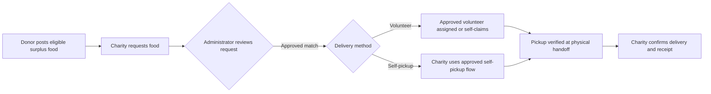

<p align="center">
  
</p>

<h1 align="center">ServaCibum</h1>

<p align="center">
  <strong>A student-built food-rescue platform that takes eligible surplus food from donation to pickup, delivery, and confirmed receipt—with every step traceable and sensitive pickup details protected.</strong>
</p>

<p align="center">
  <a href="https://servacibum.org">Live site</a> ·
  <a href="docs/ARCHITECTURE.md">Architecture</a> ·
  <a href="docs/SECURITY.md">Security &amp; Privacy</a>
</p>

<p align="center">
  
  
  
  
  
</p>


---

## Table of Contents

- [Why ServaCibum](#why-servacibum)
- [How It Works](#how-it-works)
- [Design Principles](#design-principles)
- [Engineering Highlights](#engineering-highlights)
- [Privacy and Security](#privacy-and-security)
- [Technology Stack](#technology-stack)
- [My Role](#my-role)
- [Project Status](#project-status)
- [About This Repository](#about-this-repository)
- [Repository Structure](#repository-structure)
- [Contact](#contact)

---

## Why ServaCibum

The USDA estimates that [between 30 and 40 percent of the U.S. food supply is wasted](https://www.usda.gov/about-food/food-safety/food-loss-and-waste/food-waste-faqs), while some surplus food remains [safe and wholesome enough to help feed people in need](https://www.usda.gov/about-food/food-safety/food-loss-and-waste/why-should-we-care-about-food-waste).

Small-scale food rescue can be difficult to coordinate. Someone has to connect a donor with a charity, arrange a pickup, protect sensitive contact and location information, coordinate transportation, and confirm that the food actually reached its recipient.

ServaCibum brings donors, charities, volunteers, and administrators into one structured workflow instead of relying on disconnected messages, calls, and spreadsheets.

*The name comes from Latin: **serva cibum**, “save the food.”*

---

## How It Works



1. **Post:** a donor lists eligible surplus food.
2. **Request:** a charity requests available food.
3. **Approve:** an administrator reviews the request and approves a match.
4. **Assign:** an approved volunteer is assigned or self-claims the delivery, or the charity uses an approved self-pickup flow.
5. **Verify:** pickup is confirmed at the physical handoff.
6. **Confirm:** the receiving charity confirms delivery and receipt.

The production platform provides a dedicated experience for each role:

| Role | What they do |
|---|---|
| **Donor** | Posts eligible surplus food |
| **Charity** | Requests available food, may use an approved self-pickup flow, and confirms receipt |
| **Volunteer** | Once approved, can be assigned to or self-claim eligible deliveries |
| **Administrator** | Reviews applications and requests, approves matches, and coordinates deliveries |

---

## Design Principles

- **Privacy by default.** Sensitive pickup addresses and contact details are not exposed before an approved match or assignment.
- **Approved matches.** An administrator reviews each request before food is matched.
- **Verified handoff.** One-time pickup verification confirms the physical transfer of food.
- **Controlled access.** Operational actions are restricted according to user role and approval status.
- **Traceable end to end.** Delivery state is recorded from posting through pickup and recipient confirmation.

---

## Engineering Highlights

### Workflow

- Role-based donor, charity, volunteer, and administrator experiences
- Donation and food-request matching with administrator approval
- Volunteer assignment, direct-offer, and self-claim workflows
- Charity self-pickup support
- Delivery-state tracking from assignment through confirmed receipt
- Delivery history and operational audit records

### Trust, Privacy, and Security

- Privacy-aware handling of pickup addresses and contact information
- One-time pickup verification at physical handoff
- Server-side authorization and eligibility checks for protected actions
- Driver-verification controls for approved volunteer transportation
- CSRF protection, prepared database queries, password hashing, and login-rate controls
- Public-facing content separated from private operational and administrative code

### Platform and Reliability

- Progressive Web App (PWA) support
- Offline fallback for appropriate public content
- Network-only handling for authenticated and live workflow pages
- Production secrets kept outside the public repository

---

## Privacy and Security

ServaCibum is built around controlled access to sensitive operational information.

- Pickup addresses and related contact details are not exposed publicly before an approved match or assignment.
- Authenticated actions use server-side authorization rather than relying only on interface controls.
- Driver eligibility is verified before users can access volunteer delivery functions requiring an approved driver.
- Authenticated workflows and form submissions use protections including CSRF tokens, prepared database queries, hashed passwords, and login-rate controls.
- Live and authenticated pages are kept out of the service-worker cache.
- Production credentials, participant data, private uploads, and administrative source are excluded from this public repository.

See [Security and Privacy Notes](docs/SECURITY.md) for additional information.

---

## Technology Stack

| Area | Technology |
|---|---|
| Front end | HTML, CSS, JavaScript |
| Back end | PHP |
| Database | MySQL / PDO |
| Data format | JSON |
| App experience | Progressive Web App (service worker, web manifest) |
| Version control | Git and GitHub |

---

## My Role

**Mohid Latif — Founder & Developer**

I founded ServaCibum and designed and developed its core workflow, public website, and role-based donor, charity, volunteer, and administrative experiences.

My work includes:

- Designing the end-to-end donation, request, matching, pickup, delivery, and confirmation workflow
- Building the donor, charity, volunteer, and administrator experiences
- Developing donation/request matching and volunteer-assignment logic
- Building self-claim, direct-offer, pickup-verification, and delivery-tracking workflows
- Designing privacy controls that keep sensitive pickup information hidden until it is appropriate to share
- Engineering volunteer driver-eligibility and verification controls
- Implementing security protections around authenticated workflows and form submissions
- Developing and maintaining the public website and PWA behavior
- Conducting end-to-end workflow and regression testing in preparation for a controlled community pilot

---

## Project Status

ServaCibum is being prepared and tested for a **controlled community pilot**.

The current focus is validating the platform with real-world operating procedures while maintaining administrator oversight, privacy protections, driver verification, secure pickup handoff, and end-to-end delivery confirmation before broader community use.

---

## About This Repository

This repository is a **portfolio-safe public snapshot** of ServaCibum, not a deployable copy of the full production system.

It is intended to demonstrate the project's public interface, architecture, selected application code, engineering decisions, and documentation without exposing production credentials, private participant data, or sensitive operational source.

| Included | Intentionally excluded |
|---|---|
| Public website files | Production credentials |
| Selected public application and API code | Server logs and hosting-specific files |
| PWA assets | Private participant data and uploads |
| Architecture and security documentation | Authenticated portal and administrator source |
| Example configuration templates | Live database and mail configuration |

---

## Repository Structure

```text
api/                  Public API/bootstrap code
app/                  Public JavaScript application code
assets/               Public styles and images
config/               Example configuration templates only
docs/                 Architecture and security documentation
includes/             Shared public application helpers
pwa/                  PWA icons and assets

index.html            Public homepage
about-us.php          About ServaCibum
food-safety.php       Pilot food-safety guidance
get-involved.php      Public participation/application page
privacy.php           Privacy information
terms-of-use.php      Terms of use
manifest.webmanifest  PWA manifest
sw.js                 Service worker
offline.html          Offline fallback
```

---

## Contact

**ServaCibum** · Sugar Land, Texas  
Website: [servacibum.org](https://servacibum.org)
