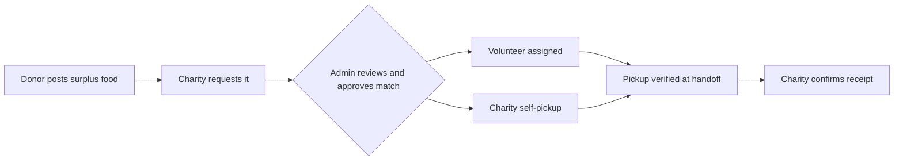

<p align="center">
  
</p>

<h1 align="center">ServaCibum</h1>

<p align="center">
  <strong>A student-built food-rescue platform that moves surplus food from donors to charities, with every step verified and traceable.</strong>
</p>

<p align="center">
  <a href="https://servacibum.org">Live site</a> ·
  <a href="docs/ARCHITECTURE.md">Architecture</a> ·
  <a href="docs/SECURITY.md">Security &amp; Privacy</a>
</p>

<p align="center">
  
  
  
  
  
</p>


---

## Table of Contents

- [Overview](#overview)
- [How It Works](#how-it-works)
- [Key Features](#key-features)
- [Privacy and Security](#privacy-and-security)
- [Technology Stack](#technology-stack)
- [My Role](#my-role)
- [Project Status](#project-status)
- [About This Repository](#about-this-repository)
- [Repository Structure](#repository-structure)
- [Contact](#contact)

---

## Overview

Small-scale food rescue often runs on scattered texts, calls, and spreadsheets. That makes it hard to coordinate pickups, protect donors' addresses, or prove that food reached the right place.

ServaCibum replaces that with one structured workflow. Donors, approved charities, volunteers, and administrators each get a dedicated experience, and every donation is tracked from posting through pickup, delivery, and confirmed receipt.

**Design goals**

- **Coordination:** one shared workflow instead of disconnected messages.
- **Privacy:** pickup addresses and contact details are revealed only after an approved match.
- **Traceability:** every handoff is verified and recorded.

---

## How It Works



1. **Post:** a donor lists eligible surplus food.
2. **Request:** a charity requests available food.
3. **Approve:** an administrator reviews the request and approves a match.
4. **Assign:** an approved volunteer is assigned, or the charity uses the approved self-pickup flow.
5. **Verify:** pickup is confirmed at the physical handoff.
6. **Confirm:** the receiving charity confirms delivery and receipt.

---

## Key Features

**Workflow and roles**

- Separate role-based experiences for donors, charities, volunteers, and administrators
- Donation and request matching with admin approval
- Volunteer assignment and self-claim workflows
- Delivery-state tracking with recipient confirmation

**Trust and safety**

- One-time pickup verification at the physical handoff
- Privacy-aware handling of pickup addresses and contact information
- CSRF protection, prepared database queries, password hashing, and login-rate controls

**Platform**

- Progressive Web App (PWA) with offline fallback
- Network-only handling for authenticated and live workflow pages
- Public content kept separate from private operational and administrative code

---

## Privacy and Security

ServaCibum is built around controlled access to sensitive operational information.

- Pickup addresses and contact details are not exposed publicly before an approved match or assignment.
- Authenticated workflows and form submissions are protected with CSRF tokens, prepared statements, hashed passwords, and rate-limited logins.
- Live and authenticated pages are never served from the service-worker cache.
- Production secrets are kept outside this public repository.

See [Security and Privacy Notes](docs/SECURITY.md) for details.

---

## Technology Stack

| Area | Technology |
|---|---|
| Front end | HTML, CSS, JavaScript |
| Back end | PHP |
| Database | MySQL (PDO) |
| Data format | JSON |
| App experience | Progressive Web App (service worker, web manifest) |
| Version control | Git and GitHub |

---

## My Role

**Mohid Latif, Founder & Developer**

I founded ServaCibum and designed and developed its core workflow, public website, and role-based donor, charity, volunteer, and administrative experiences. My work includes:

- Designing the end-to-end donation, request, matching, pickup, delivery, and confirmation workflow
- Building the four role-based experiences
- Developing the matching, volunteer-assignment, pickup-verification, and delivery-tracking logic
- Designing privacy controls so sensitive pickup information is exposed only when appropriate
- Implementing security controls for authenticated workflows and form submissions
- Developing and maintaining the public website and PWA behavior
- Testing and refining the platform for a controlled community pilot

---

## Project Status

ServaCibum is being prepared and tested for a **controlled community pilot**. The current focus is validating the workflow, privacy protections, pickup verification, and delivery process before broader use.

---

## About This Repository

This is a **portfolio-safe public snapshot**, not a deployable copy of the production system. It shows the public website, architecture, selected application code, and engineering decisions without exposing credentials or participant data.

| Included | Intentionally excluded |
|---|---|
| Public website files | Production credentials |
| Selected public application and API code | Server logs and hosting-specific files |
| PWA assets | Private participant data and uploads |
| Architecture and security documentation | Authenticated portal and administrator source |
| Example configuration templates | Live database and mail configuration |

---

## Repository Structure

```text
api/                  Public API/bootstrap code
app/                  Public JavaScript application code
assets/               Public styles and images
config/               Example configuration templates only
docs/                 Architecture and security documentation
includes/             Shared public application helpers
pwa/                  PWA icons and assets

index.html            Public homepage
about-us.php          About ServaCibum
food-safety.php       Pilot food-safety guidance
get-involved.php      Public participation/application page
privacy.php           Privacy information
terms-of-use.php      Terms of use
manifest.webmanifest  PWA manifest
sw.js                 Service worker
offline.html          Offline fallback
```

---

## Contact

**ServaCibum** · Sugar Land, Texas
Website: [servacibum.org](https://servacibum.org)
