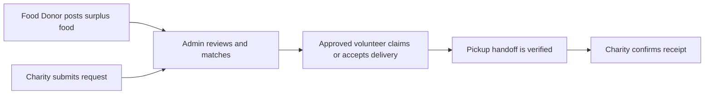

# ServaCibum Architecture

ServaCibum is a web platform for coordinating surplus-food donations between food donors, charities, volunteers, and an administrator.

## Core workflow

The production application also supports charity self-pickup. The public repository intentionally omits the authenticated production portals and administrative console while documenting their architecture.

## Main components

- **Public site** — project information, food-safety guidance, participation information, and public impact/content.
- **Public API bootstrap** — exposes only the limited data needed by the public site.
- **Food Donor portal** — donation creation, requests, pickup verification, and history.
- **Charity portal** — food requests, approved pickups/deliveries, self-pickup verification, and receipt confirmation.
- **Volunteer portal** — applications, available pickup claiming, delivery tracking, and history.
- **Admin console** — participant review, food/request matching, delivery oversight, reports, and exception handling.

## Data and privacy model

The production system is designed so exact donor pickup addresses and contact details are not exposed on the public site or open pickup board. Route/contact details are revealed only after an authorized delivery is claimed or assigned.

Pickup handoffs use a donor-controlled one-time verification code. The current production flow uses a six-digit code with a short validity window at the physical handoff.

## Public-repository scope

This repository is a portfolio-safe snapshot. It includes the public website, public API bootstrap, PWA assets, and example configuration files. Production credentials, logs, private participant data, authenticated portals, and administrative source are deliberately excluded.
