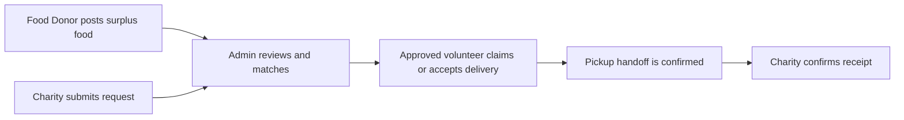

# ServaCibum Architecture

ServaCibum is a web platform for coordinating surplus-food donations between food donors, charities, volunteers, and an administrator.

## Core workflow

The production application also supports charity self-pickup.

## Main components

- **Public site** — project information, food-safety guidance, participation information, and public impact/content.
- **Public API bootstrap** — provides the data needed by the public site.
- **Food Donor portal** — donation creation, requests, pickups, and history.
- **Charity portal** — food requests, approved pickups/deliveries, self-pickup, and receipt confirmation.
- **Volunteer portal** — applications, available pickup claiming, delivery tracking, and history.
- **Admin console** — participant review, food/request matching, delivery oversight, reports, and exception handling.

## Public-repository scope

This repository is a public snapshot. It includes the public website, public API bootstrap, PWA assets, and example configuration files.
